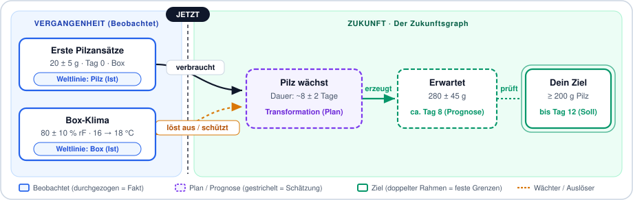
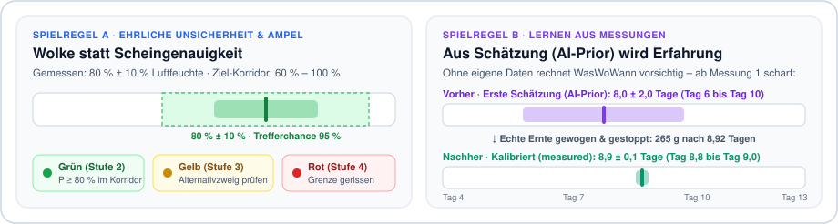

<div align="center">

# WasWoWann

**Vergangenheit beobachten. Zukunft ehrlich planen. Auf einer einzigen Weltlinie.**

[](VERSION)
[](#warum-was--wo--wann-die-weltlinie-als-leitidee)
[](#unter-der-haube--die-bausteine-im-detail)
[](metacore/README.md)

<br />



</div>

---

**WasWoWann** verbindet ein interaktives Karten- und Foto-Beobachtungsarchiv mit einem kausalen **Zukunftsgraphen**. Links der **JETZT**-Linie dokumentierst du echte Funde, Messungen und Klima-Daten; rechts davon entstehen begründete Prognosen, Rezepte und erreichbare Ziele — immer mit ehrlicher Unsicherheit (`±`) statt Scheingenauigkeit.

---

## Warum *Was – Wo – Wann*? Die Weltlinie als Leitidee

> * **Was** ist die **Entität / Identität** (z. B. *dieser Igel-Stachelbart*, *dieses Myzel-Habitat* oder *diese Körnerbrut-Charge*) — sie bleibt der rote Faden über die gesamte Zeit.
> * **Wo**, **Wann** und weitere Messwerte (**Wie viel** / Zustandseigenschaften) hängen als einzelne **Zustände** an diesem *Was* — links von **JETZT** als gemessene Vergangenheit (`observed`), rechts von **JETZT** als Prognose (`predicted`) oder Ziel (`desired`).
> * Die **Weltlinie** ist genau das Ganze zusammen: die durchgehende Lebens- und Zustands-Spur dieses *Was* durch Raum (*Wo*) und Zeit (*Wann*) — verbunden durch kausale Transformationen. Darum ist die Reihenfolge **Was – Wo – Wann** für den Zukunftsgraphen konsequent.

---

## Die 3 Ebenen einfach sortiert

| Ebene | Was sie für dich tut | Wo sie lebt |
|---|---|---|
| **1. WasWoWann** *(Gesamtsystem)* | Deine komplette Welt-Ansicht: verbindet Karte, Foto-Zeitleiste von gestern mit Plänen und Perioden von morgen. | [`frontend/`](frontend/README.md) & [`backend/`](backend/README.md) |
| **2. Zukunftsgraph** *(Blick nach vorn)* | Alles rechts von der **JETZT**-Linie: kein starrer Einkaufszettel, sondern Schritte, Abhängigkeiten, Wahrscheinlichkeiten und Ziel-Ampeln. | Tab **Zukunftsgraph** & **Perioden & Jahr** |
| **3. MetaCore** *(Motor darunter)* | Der kleine, deterministische Baukasten unter der Haube. Er braucht **nur 4 Grundbausteine** — für Pilze, Rezepte, Wetter oder Robotik. | [`metacore/`](metacore/README.md) |

---

## Die 4 Grundbausteine

WasWoWann braucht keine Sondertabellen für „Rezepte“, „Kalender“ oder „Geräte“. Alles entsteht aus denselben vier Teilen:

1. **Ding / Weltlinie** — *Worum geht es?*  
   Ein echtes Objekt über die Zeit (z. B. *Igel-Stachelbart*, *Indoor Fruchtungsbox*, *Myzelgebiet Nordwiese*).
2. **Zustand (`Ist` · `Erwartet` · `Ziel`)** — *Wie ist oder soll es sein?*  
   Jeder Zustand beschreibt **Was / Wie viel**, **Wo** und **Wann** — sauber getrennt nach Realität und Wunsch:
   * **Beobachtet (`observed`):** Echte Messung von gestern/heute (z. B. `20 ± 5 g`, `80 ± 10 % Luftfeuchte`, `Foto-GPS ± 12 m`).
   * **Vorhergesagt (`predicted`):** Begründete Prognose für morgen (z. B. `280 ± 45 g um Tag 8`).
   * **Ziel (`desired`):** Harte oder weiche Ziel-Grenzen ohne eigenes `±` (z. B. `mindestens 200 g bis Tag 12`).
3. **Transformation** — *Was passiert dazwischen?*  
   Eine bewusste Aktion (*Weizen kochen*, *Substrat autoklavieren*) oder ein Naturprozess (*Pilz fruchtet*, *Herbstschub im Wald*).
4. **Verbindung (Pfeil)** — *Wer braucht wen wofür?*

| Pfeil-Rolle | Bedeutung | Alltagsbeispiel |
|---|---|---|
| **`verbraucht`** *(consumes)* | Aus alt mach neu: Ausgangszustand geht im Ergebnis auf | *Mehl + Wasser werden zu Teig; 20 g Primordien wachsen zum Fruchtkörper* |
| **`belegt`** *(uses)* | Nur ausgeliehen: Ort oder Gerät während des Schritts reserviert | *Autoklav oder Greifer für 2 h belegt — bei Abbruch sofort wieder frei* |
| **`löst aus / schützt`** *(triggers)* | Bedingung & Wächter über das Gelingen | *Regen + Bodentemperatur lösen Herbstschub aus; Frost unter 0 °C stoppt ihn* |
| **`erzeugt`** *(produces)* | Das neue Ergebnis am Ende — immer mit fortgepflanzter `±`-Wolke | *Erwartete Ernte `280 ± 45 g` in ca. `8 ± 2 Tagen`* |

> **Gut zu wissen — Vorlage vs. konkreter Plan:**  
> Eine **Vorlage** (`template`) ist allgemeines, zeit- und ortloses Wissen (*„Igel-Stachelbart wächst ~8 Tage“*). Sobald du sie auf deinen konkreten Fund heute anwendest, entsteht daraus ein konkreter **Plan** auf deiner Weltlinie.

---

## Spielregeln, die WasWoWann besonders machen

<div align="center">

</div>

1. **Ehrliche Unsicherheit & 4-Stufen-Zielampel**  
   Ob Handy-GPS im Innenraum (Mehrfachfotos derselben Ecke machen eine Wohnung nicht plötzlich auf 1 Meter genau!) oder eine Schätzung per Waage: Unsicherheit wird ehrlich fortgepflanzt und gegen deine Ziel-Grenzen (*Wann*, *Wo*, *Wie viel*, *Vorbedingung*) geprüft — mit konkreten Auswegen (`Zweig wechseln`, `Toleranz lockern` oder sauberes `Abbrechen` inkl. Ressourcenfreigabe).
2. **Vom Bauchgefühl zur eigenen Erfahrung (`ai_prior → measured`)**  
   Fehlen lokale Messwerte, startet ein Plan ehrlich mit einem breiten Schätzwert (`ai_prior`). Sobald du die erste echte Ernte stoppst oder nachwiegst, lernt die Vorlage dazu (`measured`).
3. **Grobe Übersicht & Zoom-In (`parent_id`)**  
   Ein Ablauf wie *„Substratblock herstellen“* bleibt auf oberster Ebene ein einziger klarer Kasten — und lässt sich bei Bedarf per Klick in seine Einzelschritte (*einweichen → sterilisieren → beimpfen*) aufklappen.
4. **Zeit im Kreis denken — alle Perioden unter einem Dach**  
   Lineare Daten reichen für Wiederholungen nicht. WasWoWann projiziert Beobachtungen automatisch auf zyklische Uhren — **Tageszeit**, **Sonnenstand / Tageslicht**, **Woche**, **Kalendermonat**, **Mondzyklus (`29,53 d`)**, **Gezeiten M2 (`12,42 h`)** *(die Schwebung aus Tag & Mond)*, **Sonnenjahr (`365,24 d`)** sowie objekt-eigene **Abstände (`Δt`, z. B. Fruchtungswellen alle 14 Tage)** — und prüft statistisch sauber, ab wann ein Muster echt ist.

---

## Unter der Haube — die Bausteine im Detail

Für alle technischen Details, Datenbank-Tabellen, Mathematik, API-Endpunkte und Setup-Anleitungen gibt es eigene Dokumentationen direkt in den Modulen:

| Modul | Inhalt der Doku | Link |
|---|---|---|
| **MetaCore** | 4-Tabellen-Schema, Gauß-/ENU-Mathematik, Phasen-Trigger, Uhren & Periodik, 8 MCP-Tools & Referenz-Seeds | [**`metacore/README.md`**](metacore/README.md) |
| **Backend** | FastAPI-Routen, Datenbrücke (`waswowann.sqlite3 ↔ metacore.sqlite3`), Kalman-Ortsfusion, CLI & Sicherheit | [**`backend/README.md`**](backend/README.md) |
| **Frontend** | Next.js-Oberfläche, MapLibre-Prognosekreise (`68/95 %`), Zukunftsgraph, Perioden-Detektor & Jahresansicht | [**`frontend/README.md`**](frontend/README.md) |

---

<details>
<summary>🚀 In 2 Minuten lokal ausprobieren (Schnellstart)</summary>

> **Local-First & Datenschutz:** Alle Fotos, SQLite-Datenbanken (`data/`) und Keys (`.env`) bleiben ausschließlich lokal auf deinem Rechner. Voraussetzungen: **Python ≥ 3.12** und **Node.js ≥ 20**.

**1. Backend starten (Terminal 1):**
```sh
cd backend
python3 -m venv .venv && source .venv/bin/activate
python -m pip install -e '.[dev]'
python -m pip install --no-build-isolation --no-deps -e ../metacore
cp .env.example .env
python -m app.cli migrate
python -m app.cli seed-demo       # optional: 16 Demo-Beobachtungen
python -m app.cli sync-metacore   # baut data/metacore.sqlite3 & Zukunftsgraph-Pläne auf
uvicorn app.main:app --host 127.0.0.1 --port 8000 --reload
```

**2. Frontend starten (Terminal 2):**
```sh
cd frontend
npm ci
cp .env.local.example .env.local
npm run dev
```

Danach **[`http://localhost:3000`](http://localhost:3000)** öffnen. Die interaktive API-Referenz läuft unter `http://localhost:8000/docs`.

</details>
