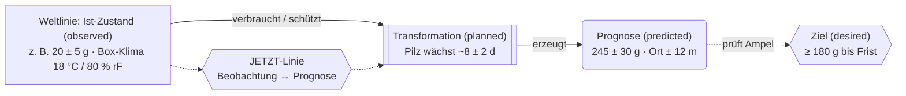

# WasWoWann — Weltlinien, Beobachtungsarchiv & Zukunftsgraph

**WasWoWann** zeigt **Vergangenheit** (was passiert ist) und **Zukunft** (was wir erwarten und erreichen wollen) auf einem einzigen Raum-Zeit-Strahl — immer ehrlich mit Unsicherheit (`μ ± σ`).

---

## Warum *Was – Wo – Wann*? Die Weltlinie als Leitidee

* **Was** ist die **Entität / Identität** (z. B. *dieser Igel-Stachelbart*, *dieses Myzel-Habitat* oder *diese Körnerbrut-Charge*) — sie bleibt der rote Faden über die gesamte Zeit.
* **Wo**, **Wann** und weitere Messwerte (**Wie viel** / Zustandseigenschaften) hängen als einzelne **Zustände** an diesem *Was* — links von **JETZT** als gemessene Vergangenheit (`observed`), rechts von **JETZT** als Prognose (`predicted`) oder Ziel (`desired`).
* Die **Weltlinie** ist genau das Ganze zusammen: die durchgehende Lebens- und Zustands-Spur dieses *Was* durch Raum (*Wo*) und Zeit (*Wann*) — verbunden durch kausale Transformationen. Darum ist die Reihenfolge **Was – Wo – Wann** für den Zukunftsgraphen konsequent.

---

## Die 3 Ebenen auf einen Blick

| Ebene | Aufgabe | Umsetzung im Monorepo |
|---|---|---|
| **1. WasWoWann** *(Gesamtsystem)* | Verbindet Karte, Foto-Zeitleiste, Beobachtungen von gestern und Pläne für morgen in einer Weboberfläche. | [`frontend/`](frontend/) (`Next.js` + `MapLibre`) & [`backend/`](backend/) (`FastAPI`) |
| **2. Zukunftsgraph** *(Blick nach vorn)* | Alles rechts von **JETZT**: kausaler Abhängigkeitsgraph (DAG), Prognose-Ellipsen auf der Karte, 4-Stufen-Zielampel und Takt-/Jahresansicht. | [`ZukunftsgraphPanel.tsx`](frontend/src/components/ZukunftsgraphPanel.tsx) & [`/api/zukunftsgraph/*`](backend/app/routes/zukunftsgraph.py) |
| **3. MetaCore** *(Motor darunter)* | Deterministische Python/SQLite-Engine für Fehlerfortpflanzung, Kalman-Fusion, `ai_prior → measured`-Kalibrierung, Uhren/Periodik und MCP-Zugriff. | [`metacore/`](metacore/) (`entities`, `states`, `transformations`, `edges`) |

---

## Die 4 Grundbausteine & die „JETZT“-Linie

Ohne Sondertabellen für „Rezepte“, „Pläne“ oder „Ressourcen“ modelliert WasWoWann alles einheitlich über **vier Bausteine**:

1. **Ding / Weltlinie (`entities`):** Ein konkretes Objekt oder Habitat über die Zeit (`kind='worldline'`) bzw. ein austauschbarer Stofftyp (`kind='type'`).
2. **Zustand (`states`):** Ein Schnappschuss mit Wert/Menge (`Wie viel`), Ort (`Wo`) und Zeit (`Wann`) in genau einer Modalität:
   * `observed` *(Ist)* — real gemessen mit ehrlicher Messunsicherheit (`± σ`)
   * `predicted` *(Erwartet)* — berechnete Vorausschau mit Prognoseunsicherheit (`± σ`)
   * `desired` *(Ziel / Soll)* — klare Ziel-Grenzen (Min/Max, Frist, Zielradius) ohne `σ`
   * `cancelled` — sauber abgeschlossener / abgebrochener Ast
3. **Transformation (`transformations`):** Ein Vorgang (`actor` oder `nature`), der bestehende Zustände in neue überführt (`happened`, `planned` oder wiederverwendbare `template`-Vorlage). Teilprozesse lassen sich über `parent_id` hierarchisch verschachteln (Makroschritt ↔ Zoom-In auf Unterschritte).
4. **Verbindung / Pfeil (`edges`):** Verknüpft Zustand und Transformation mit klarer Rolle:
   * `consumes` *(verbraucht)* — Ausgangszustand geht in das Ergebnis über
   * `uses` *(belegt)* — Ressource/Gerät wird für die Dauer reserviert (mit Konfliktprüfung & Freigabe bei Abbruch)
   * `triggers` *(löst aus / schützt)* — Bedingung, Verhältnis-Wächter, Klima-Modifikator oder Phasen-Uhr
   * `produces` *(erzeugt)* — resultierender Zustand mit fortgepflanzter `± σ`-Unsicherheit



---

## Kernfunktionen im Überblick

* **Ehrliche Unsicherheit & Gauß-/Kalman-Fusion:** Unabhängige GPS-/Messpunkte schärfen per präzisionsgewichteter ENU-Fusion (`± σ / √n`); korrelierte Indoor-Serien teilen eine `measurement_source` (`indoor:<obs_id>`), sodass ihre Ortsunsicherheit nicht künstlich schrumpft. Verstreute Einzelfunde lassen sich zu konservativen Habitat-Gebieten generalisieren.
* **4-Stufen-Zielampel & Eskalation (`wann`, `wo`, `wie_viel`, `vorbedingung`):**
  * **Stufe 1:** Ereignis-Trigger startet Vorlage automatisch (z. B. Herbst-Saison + Regen + Bodentemperatur)
  * **Stufe 2 (`on_track`):** Alle Zieldimensionen im Korridor (`P ≥ 80 %`)
  * **Stufe 3 (`at_risk`):** Plan gefährdet → automatische Suche nach Alternativzweigen (`CHOICE_OR` / `WORLD_OR`)
  * **Stufe 4 (`broken`):** Klare Diagnose der gebrochenen Dimension(en) + Aktionen `switch_branch`, `widen_tolerance` oder kaskadierendes `abort_goal` (gibt `uses`-Ressourcen frei).
* **`ai_prior → measured` Lernzyklus:** Neue Vorlagen dürfen KI-Startschätzungen (`source='ai_prior'`) mit breitem `σ` nutzen. Ab der ersten echten Messung kalibriert die Engine den Parameter auf `measured` nach.
* **Zeitliche Perioden, Uhren & Takt-Erkennung (`clocks.py`):**
  * **7 globale Uhren:** Tageszeit (`24 h`), Sonnenstand / Tageslicht (aus `lat, lon`), Woche (`7 d`), Kalendermonat, synodischer Mondzyklus (`29,53 d`, inkl. Springtide-Bereich), Gezeiten M2 (`12,4206 h` — die zweite Schwebungs-Harmonische aus Erdrotation vs. Mondumlauf) und Sonnenjahr (`365,2425 d`, Tag `1–366`).
  * **8. Uhr – Eigen-Intervalle (`relative_interval`):** Wiederkehr-Abstände `Δt ± σ` direkt zwischen Ereignissen derselben Weltlinie (z. B. 14-Tage-Fruchtungswellen), geschützt durch automatische Burst-Deduplizierung.
  * **Automatischer Perioden-Detektor:** Projiziert beliebige Zeitreihen auf alle Uhren (`R`-Konzentration, abgedeckte Zyklen, Rayleigh-Signifikanz), wertet `period_phase`-Trigger/Wächter aus und berechnet das nächste Zeitfenster rechts von `JETZT`.

---

## Monorepo-Struktur

```text
WasWoWann/
├── metacore/        # Eigenständiger Python/SQLite-MetaCore, Clocks-Engine & MCP-Server (waswowann-mcp)
├── backend/         # FastAPI-API, EXIF/Upload-Ingest, Kalman-Fusion, SQLite-Bridge & REST-Endpunkte
├── frontend/        # Next.js 15 + TypeScript + MapLibre-Karte, Zukunftsgraph & Perioden & Jahr
├── data/            # Lokale SQLite-Datenbanken & Fotos (bewusst in .gitignore)
├── PROJEKTPLAN.md
└── UMSETZUNGSPLAN.md
```

---

## Voraussetzungen & Schnellstart (Lokal)

* **Python ≥ 3.12** und **Node.js ≥ 20** (inkl. `npm`)
* Alle Daten (`data/`), Datenbanken (`waswowann.sqlite3`, `metacore.sqlite3`) und Secrets (`.env`) bleiben ausschließlich lokal auf deinem Rechner. Das Backend bindet standardmäßig an `127.0.0.1` (Single-User-Betrieb, nicht ohne Härtung ins Internet freigeben).

### 1. Backend einrichten & starten
```sh
cd backend
python3 -m venv .venv
source .venv/bin/activate
python -m pip install -e '.[dev]'
python -m pip install --no-build-isolation --no-deps -e ../metacore
cp .env.example .env
python -m app.cli migrate
python -m app.cli seed-demo      # optional: 16 Demo-Beobachtungen anlegen
python -m app.cli sync-metacore  # synchronisiert Beobachtungen & Pläne nach data/metacore.sqlite3
uvicorn app.main:app --host 127.0.0.1 --port 8000 --reload
```

### 2. Frontend starten
```sh
cd frontend
npm ci
cp .env.local.example .env.local
npm run dev
```
Anschließend `http://localhost:3000` öffnen (OpenAPI-Doku unter `http://localhost:8000/docs`).

### 3. MetaCore MCP-Server (optional für Agenten / LLMs)
```sh
cd metacore
python3 -m venv .venv
source .venv/bin/activate
pip install -e '.[dev]'
waswowann-mcp
```

---

## Tests & Qualitätschecks

```sh
# MetaCore (Engine, Mathematik, Clocks, MCP-Server, Visualizer)
cd metacore && .venv/bin/pytest -v && .venv/bin/ruff check src tests

# Backend (Ingestion, Kalman-Fusion, Object Timeline, Zukunftsgraph-API)
cd backend && .venv/bin/pytest -v

# Frontend (Unit-Tests, TypeScript-Check, Production Build, E2E)
cd frontend && npm test -- --run && npm run lint && npm run build
npx playwright install chromium   # einmalig
npm run test:e2e
```
